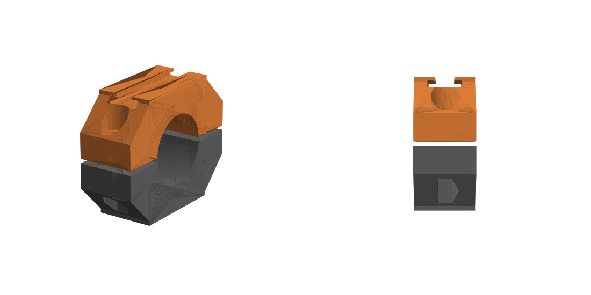
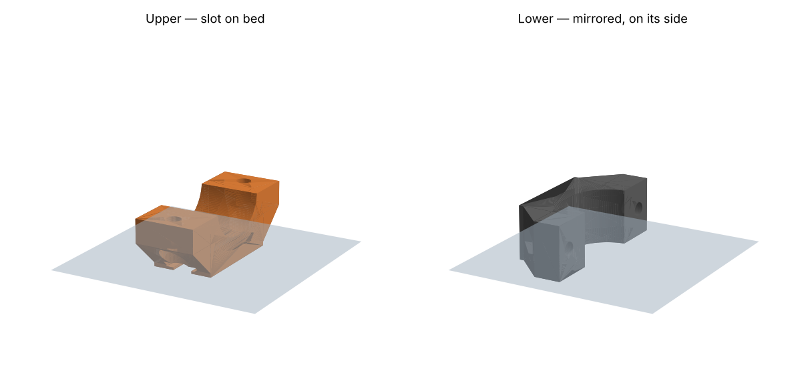

# Bike lamp handlebar clamp

Two-part PETG clamp for a 22.2 mm handlebar, with a T-slot that takes the T-rail on the underside of a bike lamp. The halves bolt together with two M4 screws.

## Files

| File | Purpose |
|---|---|
| `stl/clamp_upper.stl` | Upper half with the T-slot, already in print orientation (slot on the bed) |
| `stl/clamp_lower.stl` | Lower half with nut traps, already in print orientation (on its side) |
| `scad/bike_lamp_clamp.scad` | Parametric OpenSCAD source |
| `tools/build_stl.py` | Python (manifold3d + trimesh) build that mirrors the SCAD. It writes the STLs and the preview, and checks that the meshes are watertight and support-free |

## Dimensions

| Feature | Value |
|---|---|
| Handlebar | Ø22.2 mm (`bar_d`) |
| Clamp width | 18 mm |
| Outer size | 18 × 49 × 39 mm assembled |
| T-slot | 30 mm long, 5.5 mm opening, 10 mm inner width, 2.7 mm deep with 0.8 mm lips; +0.25 mm fit clearance |
| Screws | 2 × M4×20 socket head + 2 × M4 nuts, 19.5 mm from the centre |
| Split gap | 1.5 mm |

## Printing

- PETG, 0.2 mm layers, 4 walls, no supports.
- Upper half: slot on the bed. Set elephant-foot compensation to about 0.15 mm, otherwise the 5.5 mm slot opening prints narrow.
- Lower half: printed on its side so the layers run around the arch. Use 100% infill. The first version, printed flat, snapped at the corner between the ear and the arch.

## Assembly

1. Seat the nuts in the hex tunnels on the lower half. Pliers or a long hex key help.
2. Put a strip of rubber (old inner tube) around the bar, then the halves.
3. Tighten the screws evenly. Stop when the gap is about 0.5 mm, because the halves must not touch.
4. Slide the lamp's T-rail into the slot.

## Tuning

- Slot too tight: lower `lip_h` (0.8) or raise `fit` (0.25) in 0.05 mm steps.
- Different bar: change `bar_d`. The screws move outward automatically to stay clear of the slot.

## Status / to do

- The upper half has been printed and fits. The first version had 1.0 mm lips and needed sanding, so they are now 0.8 mm.
- Not tested yet: the mirrored lower half and the 0.8 mm lips.
- Planned: a spring lock tab with a notch, like the original mount. This needs measurements of the notch on the lamp.
- The SCAD file has not been rendered in OpenSCAD yet. The STLs come from `tools/build_stl.py`.
