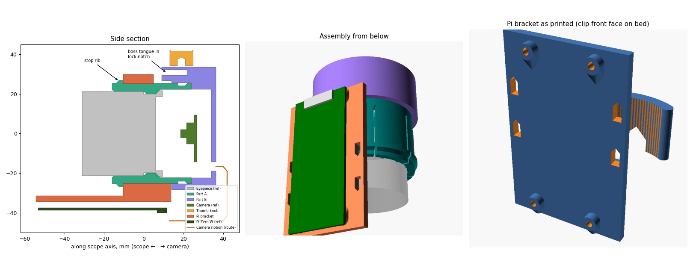
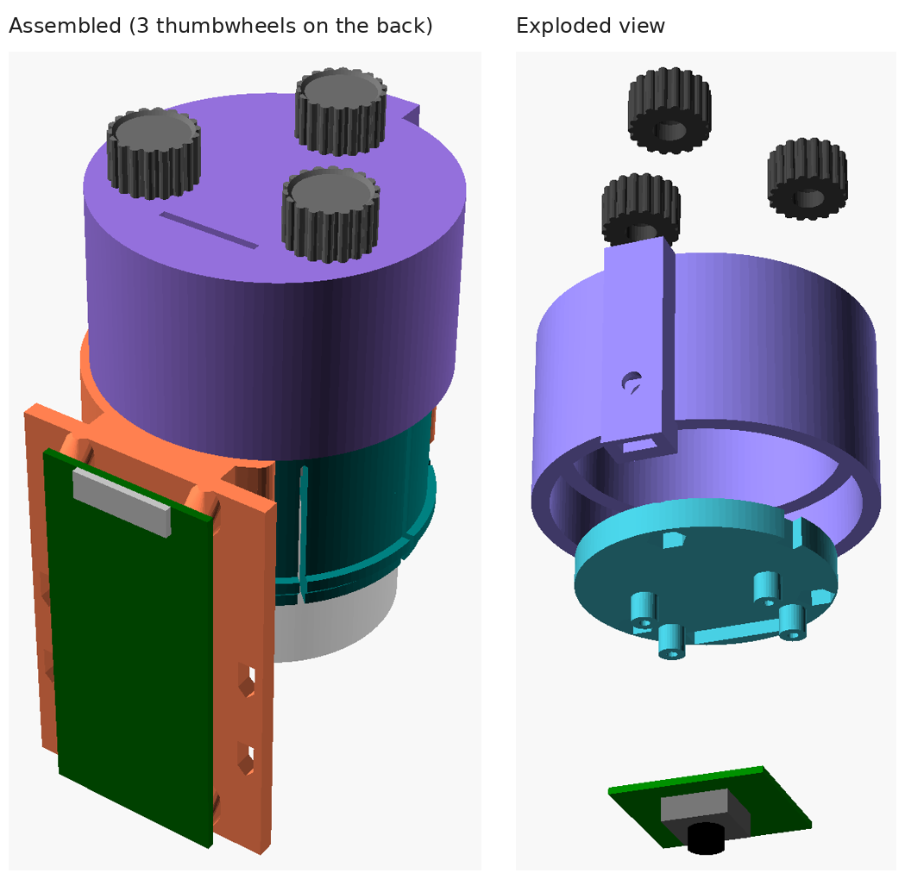
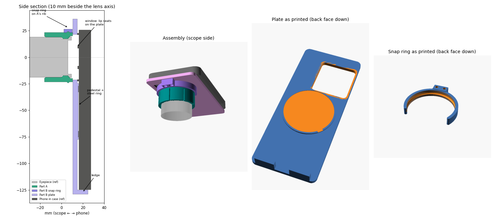

# Bresser 20-60x spotting scope – camera mounts (OpenSCAD)

Parametric, **support-free** 3D-printable mounts that attach a camera to the eyepiece of a Bresser 20-60x spotting scope for afocal photography.

| Version | Camera | Files |
|---|---|---|
| **Pi** | Raspberry Pi Camera Module 3 + Pi Zero W | `scad/bresser_picam3_mount.scad` |
| **Pi (clamshell Part A)** | same, bolted clamshell instead of snug fit (needs supports) | `scad/bresser_picam3_mount_clamshell.scad` |
| **Pi, focus plate** | same, camera on a spring-loaded plate with 3 thumbwheels (focus distance + tilt) | `scad/bresser_picam3_mount_float.scad` |
| **iPhone** | iPhone 15 Pro (Spigen Mag Armor), telephoto, MagSafe ring, portrait | `scad/bresser_iphone_mount.scad` |





## Quick start
```bash
sudo apt install openscad            # 2021.01 is enough
tools/build_stl.sh                   # regenerate all STLs in stl/
pip install trimesh shapely rtree numpy
python3 tools/check_printable.py stl/*.stl   # watertight + support-free layer check
```
Or open a `.scad` in OpenSCAD and use the Customizer; pick a part with the `part` variable.

## Print list (Bambu A1, PLA, 0.2 mm, no supports)
| STL | Orientation on bed |
|---|---|
| `part_a_snug` | rear end down |
| `part_b` | back wall down |
| `knob` | flat side down |
| `pi_bracket` | clip front face down |
| `float_part_b` | back wall down |
| `float_cam_plate` | back face down (standoffs up) |
| `float_wheels` (3) | flat side down |
| `iphone_part_a`, `iphone_b_ring`, `iphone_b_plate` | back face down |

`shims.stl`, `iphone_test_window.stl` are fit-test helpers. Clamshell halves need supports for bolt ears.

**Start with `PROJECT.md`** – all measurements, design decisions, open items, and how to continue in a new session.
