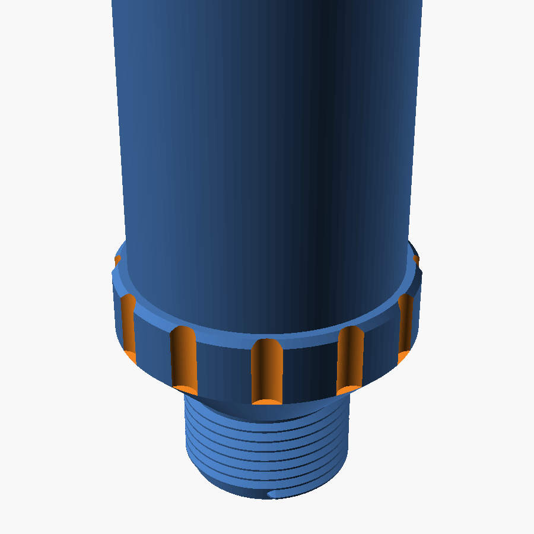

# Kärcher WD3 → G3/4 adapter

3D-printable adapter that connects a Kärcher WD3 wet/dry vacuum (DN35 wand/hose end) to a **male G3/4 (BSPP)** thread. Use it to suck or blow the water out of a garden sprinkler system before winter.

It screws into the female G3/4 coupling (with its own flat gasket) on the pipe right after the tap. The flat end face of the adapter presses on that gasket to seal.

## Files

| File | Purpose |
|---|---|
| `stl/adapter.stl` | The adapter |
| `stl/fit-test-coupon.stl` | 8 mm of thread + a 10 mm socket ring, about 20 min print, to check fit first |
| `scad/adapter.scad` | Parametric OpenSCAD source (needs [BOSL2](https://github.com/BelfrySCAD/BOSL2)) |

## Dimensions

| Feature | Value |
|---|---|
| Thread | G3/4 BSPP, 14 TPI (1.814 mm pitch), 55° Whitworth; Ø26.14 mm (nominal 26.441 minus 0.30 mm print clearance) |
| Thread length | 16 mm |
| Through-bore | Ø18 mm |
| Vacuum socket | 40 mm deep, tapering Ø35.15 → Ø35.55 mm, for the Ø35.3 mm Kärcher DN35 wand end |
| Grip collar | Ø46 mm, 12 flutes |
| Overall height | about 85 mm |

## Printing

- Material: PETG recommended
- Orientation: thread end down on the bed, no supports (45° transitions)
- 5+ walls, 0.15 mm layers
- Print the coupon first. If the thread is tight, raise `thread_clear` (try 0.4). If the socket is loose, lower `socket_clear_bot`.

All fit parameters are variables at the top of `scad/adapter.scad`.

## Usage

1. Remove the sprinkler heads and cap every outlet except the furthest one. Air has to enter at the far end, otherwise the vacuum only pulls the line flat.
2. Hand-tighten the adapter onto the pipe after the tap.
3. Run the WD3 in wet mode (filter removed or foam filter fitted) in **suction** mode. Suck until only air comes through.
4. Cap that outlet, open the next-furthest, repeat back toward the tap.
5. Optional: finish with a short blast in blow mode if water still gurgles in a low section.

Empty the vacuum tank and dry the filter afterwards.

## Notes

- G3/4 is the European parallel pipe thread (BSPP), not NPT.
- Vacuum is only around 0.2 bar, so hand-tight is enough.
- Verified by printing; the thread and socket fit worked as designed.

## Sources for the dimensions

- G3/4 BSPP: ISO 228 / BS 2779 thread tables (major Ø26.441 mm, 14 TPI)
- Kärcher DN35 accessory size; wand end measured about 35.3 mm

## License

MIT, see [LICENSE](LICENSE).
